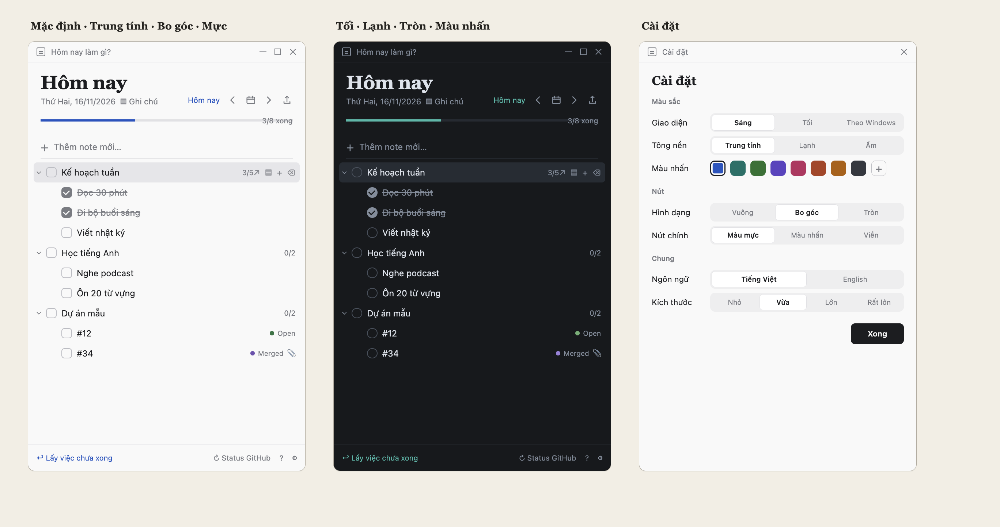

# TodayChecklist — thiết kế

Một cuốn sổ ghi việc trong ngày, không phải một dashboard. Màu sắc và kiểu nút chỉnh được trong **Cài đặt** (nút ⚙ hoặc Ctrl+,), nhưng mọi lựa chọn vẫn theo 3 nguyên tắc:

1. **Nền yên, chữ đậm.** Nền và chữ là một dải xám (trung tính, lạnh hoặc ấm). Màu chỉ xuất hiện khi mang thông tin.
2. **Một màu nhấn, dùng ít.** Màu nhấn chỉ dành cho "đang ở đây / đang làm": thanh tiến độ, ô đang gõ, vạch dòng đang chọn, ngày hôm nay, link khi rê chuột. Nút chính chỉ dùng màu nhấn khi chọn kiểu "Màu nhấn".
3. **Kẻ thay vì hộp.** Phân tách bằng đường kẻ mảnh và khoảng trắng. Độ bo góc do một cài đặt duy nhất quyết định, nên nút, ô tick, hàng, lịch và nhóm lựa chọn luôn cùng một kiểu.

## Cài đặt và mặc định

| Nhóm | Cài đặt | Lựa chọn | Mặc định |
|---|---|---|---|
| Màu sắc | Giao diện | Sáng / Tối / Theo Windows | Sáng |
| | Tông nền | Trung tính / Lạnh / Ấm | Trung tính |
| | Màu nhấn | 8 màu có sẵn + tự chọn màu bất kỳ | Xanh dương |
| Nút | Hình dạng | Vuông / Bo góc / Tròn | Bo góc |
| | Nút chính | Màu mực / Màu nhấn / Viền | Màu mực |
| Chung | Ngôn ngữ | Tiếng Việt / English | Tiếng Việt |
| | Kích thước | Nhỏ / Vừa / Lớn / Rất lớn (×0.9 / 1 / 1.15 / 1.3) | Vừa |

Cài đặt lưu trong bảng `settings` của file DB. Bấm tới đâu áp dụng ngay tới đó.

## Màu

Token nằm trong `Theme.cs`. Code chỉ dùng token, không viết màu trực tiếp (trừ chấm trạng thái GitHub).

### Tông nền (bản sáng / bản tối)

| Token | Vai trò | Trung tính | Lạnh | Ấm |
|---|---|---|---|---|
| `Bg` | nền mọi thứ, cả thanh tiêu đề | `#FAFAFA` / `#1B1B1D` | `#F7F9FB` / `#171A1F` | `#FAF8F4` / `#1C1B19` |
| `Raised` | mục đang bật trong nhóm lựa chọn | `#FFFFFF` / `#333336` | `#FFFFFF` / `#2E333B` | `#FFFFFF` / `#34322E` |
| `Field` | rãnh nhóm lựa chọn, nền nút khi rê chuột | `#F0F0F1` / `#252527` | `#EDF1F5` / `#21252B` | `#F2EFE9` / `#252421` |
| `Hover` / `Selected` | dòng rê chuột / đang chọn | `#F4F4F5` `#E9E9EC` | `#F1F4F8` `#E4EAF1` | `#F5F2ED` `#EDE8DF` |
| `Line` | đường kẻ, rãnh tiến độ | `#E5E5E8` / `#2E2E32` | `#E1E6ED` / `#2A3038` | `#E7E2D9` / `#2F2D2A` |
| `Border` | viền ô tick, nút phụ | `#C4C5CA` / `#57585D` | `#BAC4D0` / `#525B67` | `#C8C2B7` / `#5A5650` |
| `Muted` | chữ phụ, việc đã xong, icon | `#84868D` / `#94959B` | `#7B8695` / `#8E98A6` | `#8A847A` / `#979187` |
| `Text` | chữ chính, nút chính kiểu "Màu mực" | `#1E1F23` / `#E6E6E9` | `#1B212A` / `#E2E7EE` | `#23211D` / `#E8E4DC` |

Ở bản tối, các bảng màu được giữ gần giống bản sáng của cùng tông: không dùng đen tuyền, không dùng xanh than.

### Màu nhấn (bản sáng / bản tối)

| Xanh dương | Xanh ngọc | Xanh lá | Tím | Hồng | Đỏ son | Cam | Mực |
|---|---|---|---|---|---|---|---|
| `#2F62C8` / `#7AA2F0` | `#0E7C72` / `#4FC1B1` | `#2F7D3A` / `#7CC488` | `#6B4FC8` / `#A994F2` | `#C1356B` / `#F07FA6` | `#B5492B` / `#E07A58` | `#B8680C` / `#E8A55A` | `#3C4048` / `#CDD0D6` |

- **Màu tự chọn:** bản sáng dùng đúng màu đã chọn. Bản tối được pha thêm 30% trắng để đọc được trên nền tối.
- **`AccentHover`:** pha 14% đen (bản sáng) hoặc trắng (bản tối).
- **`OnAccent`:** chữ trên nền màu nhấn, tự chọn trắng hoặc mực tùy màu nào có độ tương phản WCAG cao hơn.
- **Màu trạng thái:** `Success`, `Warning`, `Danger` không đổi theo tông.

Trạng thái GitHub chỉ là **một chấm màu kèm chữ xám**, không tô nền. Màu chấm giữ nghĩa quen thuộc của GitHub: Open xanh lá, Merged và Closed (issue) tím, Closed (PR) đỏ, Draft và Not planned xám.

## Chữ

| Vai trò | Font | Cỡ (Vừa) |
|---|---|---|
| Tiêu đề ngày | Sitka Heading Semibold (serif, cỡ quang học cho tiêu đề) | 21 pt |
| Tiêu đề hộp thoại, tháng trong lịch | Sitka Subheading Semibold | 11.5–12.5 pt |
| Note gốc | Segoe UI Variable Text Semibold | 10.5 pt |
| Việc con, nội dung | Segoe UI Variable Text | 10.5 pt |
| Ngày, bộ đếm, nhãn | Segoe UI Variable Text | 9–9.5 pt |
| Nhãn trạng thái GitHub | Segoe UI Variable Small | 8.5 pt |

- Serif chỉ dùng cho tiêu đề.
- Font dự phòng: không có Sitka thì dùng Georgia; không có Segoe UI Variable thì dùng Segoe UI.
- Icon dùng Segoe Fluent Icons. Không dùng ký tự Unicode (↻ ↪ ✓) làm icon.

## Hình dạng

`Theme.Corner(control, chiều cao, bo mặc định)` trả về bán kính bo theo cài đặt:

- **Vuông** = 0.
- **Bo góc** = bán kính mặc định của từng phần (xem bảng), nhưng không quá nửa chiều cao.
- **Tròn** = nửa chiều cao, tức hình viên thuốc. Với khối vuông thì thành hình tròn.

| Thành phần | Bo góc | Tròn |
|---|---|---|
| Nút, nút trên thanh công cụ (nền khi rê chuột) | 6 px | viên thuốc / tròn |
| Hàng trong danh sách (rê chuột, đang chọn, gợi ý thả) | 5 px | viên thuốc; vạch chọn ngắn lại 12 px và lùi vào trong |
| Ô tick | 4.5 px | tròn |
| Ô ngày trong lịch, nút ‹ › của lịch | 6 px | tròn |
| Nhóm lựa chọn: rãnh / mục đang bật | 7 / 5 px | viên thuốc |
| Ô màu nhấn | 6 px | tròn |

Thanh cuộn luôn bo tròn. Tooltip và menu luôn vuông.

## Nút

Mọi nút đều do `ThemedButton` tự vẽ.

| Loại | Nền | Viền | Chữ |
|---|---|---|---|
| Thanh công cụ (`FlatButton`) | trống; `Field` khi rê chuột, `Press` khi bấm | — | `Muted` (nút "Hôm nay": màu nhấn) |
| Nút phụ (Hủy, Không) | trống; `Field` khi rê chuột | `Border` 1 px | `Text` |
| Nút chính kiểu **Màu mực** | `Text`; `PrimaryHover` khi rê chuột | — | `Bg` |
| Nút chính kiểu **Màu nhấn** | `Accent`; `AccentHover` khi rê chuột | — | `OnAccent` |
| Nút chính kiểu **Viền** | trống; `Field` khi rê chuột | `Text` 1.5 px | `Text` |

Ngày đang chọn trong lịch theo đúng kiểu nút chính.

## Thành phần khác

- **Ô tick:** viền `Border` 1.5 px. Rê chuột thì viền màu chữ chính và hiện mờ dấu tick. Đã xong thì nền `Muted`, tick màu nền. Việc xong lùi thành chữ xám gạch ngang.
- **Cấp bậc trong cây:** chỉ thể hiện bằng thụt lề (24 px mỗi cấp) và chevron. Không vẽ đường dẫn dọc, vì trông lạc lõng giữa các hàng.
- **Link:** bình thường trông như chữ thường, không có gạch chân. Rê chuột lên tên việc thì chữ chuyển màu nhấn, có gạch chân và con trỏ hình bàn tay.
- **Ô thêm việc:** không có khung, chỉ có icon và chữ trên một dòng kẻ. Đang gõ thì dòng kẻ dày 2 px, màu nhấn.
- **Thanh tiến độ:** đường kẻ 3 px đầu vuông, rãnh `Line`, phần đã làm màu nhấn. Xong hết thì chuyển `Success`.
- **Tooltip:** đảo màu, nền màu chữ chính, chữ màu nền.
- **Thanh tiêu đề cửa sổ:** cùng màu `Bg`, sáng hoặc tối theo theme.
