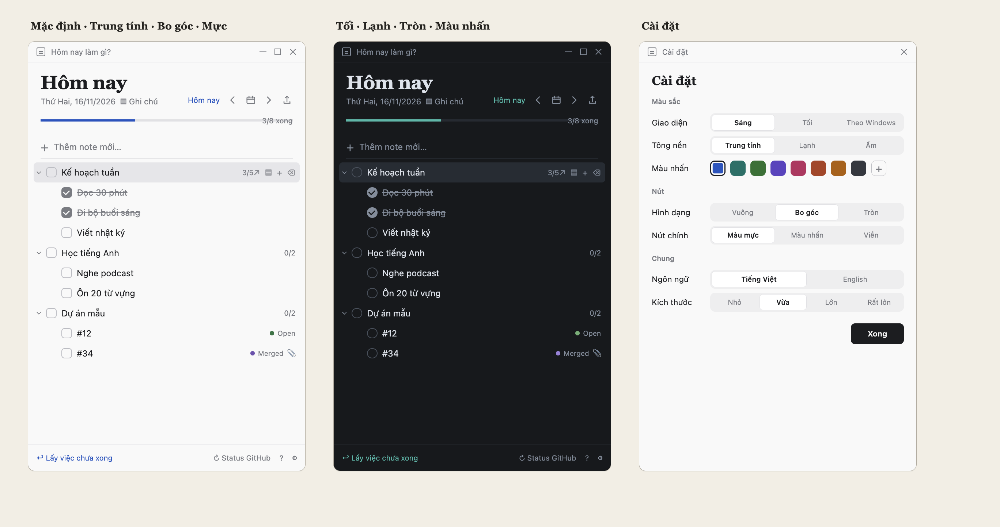

# TodayChecklist

[](https://github.com/phamhminhkhoi/TodayChecklist/actions/workflows/build.yml)

**Một cuốn sổ ghi việc trong ngày cho Windows.** Không tài khoản, không cloud, không dashboard. Mở lên là thấy hôm nay; gõ việc; tick xong; đóng lại. Việc chưa xong tự chép sang ngày làm việc kế tiếp. Task có link GitHub issue / PR thì hiện luôn status và coding checklist.



> Ảnh minh họa được dựng từ `design/mockup.html`, không phải screenshot chạy thật và không chứa dữ liệu thật.

## Tính năng

- **Sổ việc theo ngày**: cây note → việc con → cháu, tick xong, thanh tiến độ, ẩn việc đã xong.
- **Tự chép việc chưa xong** từ ngày gần nhất sang hôm nay, giữ nguyên cây, ghi chú, tệp đính kèm và nhóm.
- **Lịch** đánh dấu những ngày còn việc chưa xong; nhảy nhanh về hôm nay.
- **GitHub (chỉ đọc)**: gắn link issue / PR, lấy status từ GitHub Project hoặc trạng thái open / draft / merged / closed / not planned, hiện tên issue cho các dòng `#18`, phát hiện coding checklist.
- **Liên kết task**: gom các task cùng một việc lớn (ví dụ issue ở 2 repo) để tô cùng màu và mở link cả nhóm.
- **Ghi chú & tệp đính kèm** cho từng việc; chỉ lưu đường dẫn, không copy file.
- **Ghi chú chung** không theo ngày, mở từ bất kỳ đâu bằng `Ctrl+Win+Alt`.
- **Tìm kiếm mọi ngày**, không cần gõ dấu tiếng Việt (`cap nhat` vẫn ra `cập nhật`).
- **Danh sách việc đã xong** kèm ngày và giờ hoàn thành.
- **Khay hệ thống + phím tắt toàn cục** để gọi app lên thêm việc, hoặc cất đi.
- **Giao diện tùy biến**: sáng / tối / theo Windows, 3 tông nền, 8 màu nhấn + màu tự chọn, 3 kiểu nút, 4 cỡ chữ, tiếng Việt / English.
- **Dữ liệu local**: một file SQLite, không server, không telemetry.

## Yêu cầu

| | |
|---|---|
| Hệ điều hành | Windows 10/11 (x64 hoặc ARM64) |
| Chạy bản publish | [.NET 10 Desktop Runtime](https://dotnet.microsoft.com/download/dotnet/10.0) |
| Build từ source | .NET 10 SDK |
| Status GitHub đầy đủ (tuỳ chọn) | GitHub CLI đã đăng nhập, hoặc biến môi trường `GH_TOKEN` / `GITHUB_TOKEN` |

App dùng font hệ thống của Windows 11 (`Segoe UI Variable`, `Sitka`, `Segoe Fluent Icons`); trên Windows 10 sẽ tự lùi về `Segoe UI`, `Georgia`, `Segoe MDL2 Assets`.

## Bắt đầu nhanh

### Tải bản phát hành

Vào [Releases](https://github.com/phamhminhkhoi/TodayChecklist/releases/latest), tải file `TodayChecklist-v*-win.zip`, giải nén và chạy `TodayChecklist.exe`.

Bản phát hành là **framework-dependent**: cần cài [.NET 10 Desktop Runtime](https://dotnet.microsoft.com/download/dotnet/10.0) trước khi chạy.

### Chạy từ source

```powershell
git clone https://github.com/phamhminhkhoi/TodayChecklist.git
cd TodayChecklist
dotnet run
```

Hoặc build bản Release:

```powershell
dotnet build TodayChecklist.sln -c Release
```

### Cài bản Release vào máy

```powershell
.\deploy.cmd
```

Script sẽ publish vào `%LOCALAPPDATA%\Programs\TodayChecklist\app-<thời gian>`, rồi trỏ junction `current` sang bản mới. Shortcut nên trỏ tới:

```text
%LOCALAPPDATA%\Programs\TodayChecklist\current\TodayChecklist.exe
```

Muốn đóng app đang chạy (kể cả đang ở khay hệ thống) và mở bản mới:

```powershell
.\deploy.cmd -Restart
```

`deploy.cmd` gọi `deploy.ps1` với `-ExecutionPolicy Bypass`, nên không cần đổi policy của PowerShell. Script giữ 3 bản gần nhất.

### Bản build từ GitHub Actions

Mỗi lần push lên `main`, workflow [build](.github/workflows/build.yml) build trên Windows và upload artifact `TodayChecklist-win`. Vào tab **Actions → build → lần chạy mới nhất → Artifacts** để tải. Artifact giữ 14 ngày.

Khi push tag `v*`, workflow [release](.github/workflows/release.yml) build và tạo GitHub Release kèm file zip.

## Sử dụng cơ bản

1. **Thêm việc**: gõ vào ô `+ Thêm note mới…` rồi `Enter`.
2. **Thêm việc con**: chọn dòng cha, bấm `Ctrl+Enter`.
3. **Tick xong**: bấm ô vuông hoặc `Space`. Tick cha sẽ tick toàn bộ con; con xong hết thì cha tự xong.
4. **Đổi ngày**: `Ctrl+PgUp` / `Ctrl+PgDn`, hoặc bấm icon lịch. Ngày có chấm là còn việc chưa xong.
5. **Chép việc chưa xong**: app tự làm đầu ngày (có thể tắt trong Cài đặt), hoặc bấm `Lấy việc chưa xong`.
6. **GitHub**: dán link issue / PR vào ô thêm việc, hoặc chọn việc rồi `Ctrl+L`. Bấm `F5` hoặc để app tự cập nhật status.

Hướng dẫn đầy đủ: **[docs/USAGE.md](docs/USAGE.md)**.

## GitHub status

App **chỉ đọc** GitHub, không comment, không đóng issue, không sửa gì trên repo.

Để lấy status đầy đủ (kể cả cột Status trong GitHub Project):

```powershell
gh auth login
gh auth refresh -s read:project
```

Hoặc đặt biến môi trường:

```powershell
$env:GH_TOKEN = "ghp_..."
```

Token chỉ giữ trong bộ nhớ, **không lưu vào DB**. Không có token, app vẫn đọc được issue / PR của repo public qua REST (open / draft / merged / closed / not planned), nhưng không có status từ GitHub Project và không có coding checklist.

| Nguồn status | Hiển thị |
|---|---|
| Cột `Status` của GitHub Project | Tên option + màu của option đó |
| Issue / PR đang mở | `Open` (xanh lá) |
| PR draft | `Draft` (xám) |
| PR đã merge | `Merged` (tím) |
| PR đóng không merge | `Closed` (đỏ) |
| Issue đã đóng | `Closed` (tím) |
| Issue closed as not planned / duplicate | `Not planned` (xám) |

Status chỉ hiện khi link hiện tại vẫn là link lúc lấy status. Đổi link thì status cũ tự ẩn.

## Dữ liệu

Mặc định:

```text
%LOCALAPPDATA%\TodayChecklist\checklist.db
```

Có thể mở một DB khác bằng tham số đầu tiên:

```powershell
TodayChecklist.exe "D:\Todo\checklist-test.db"
```

Mỗi file DB chỉ cho phép một cửa sổ; mở lại cùng DB sẽ đưa cửa sổ đang chạy lên. Các DB khác nhau chạy song song được.

**Sao lưu thủ công**: đóng app rồi copy file `checklist.db`. Hiện app chưa có nút backup tự động và chưa có undo khi xóa — xem [Giới hạn hiện tại](#giới-hạn-hiện-tại).

Tệp / thư mục đính kèm chỉ lưu đường dẫn tuyệt đối; di chuyển hoặc xóa file gốc thì app sẽ báo "không còn trên máy".

## Phím tắt thường dùng

| Phím | Việc |
|---|---|
| `Enter` | Thêm việc cùng cấp / lưu tên đang sửa |
| `Ctrl+Enter` | Thêm việc con |
| `F2` / double-click | Sửa tên |
| `Space` | Tick xong / bỏ tick |
| `Delete` | Xóa |
| `Alt+↑` / `Alt+↓` | Đổi thứ tự |
| `Alt+←` / `Alt+→` | Lùi / thụt cấp |
| `Ctrl+L` | Gắn / sửa link |
| `Ctrl+O` | Mở link |
| `Ctrl+G` | Liên kết các task cùng nhóm |
| `Ctrl+E` | Ghi chú & tệp đính kèm |
| `Ctrl+F` | Tìm ở mọi ngày |
| `Ctrl+H` | Danh sách việc đã xong |
| `Ctrl+Shift+H` | Ẩn / hiện việc đã xong |
| `Ctrl+J` | Ghi chú chung |
| `Ctrl+Win+Alt` | Mở / đóng ghi chú chung từ bất kỳ đâu |
| `Ctrl+Alt+T` | Gọi app lên / cất đi (đổi được trong Cài đặt) |
| `F5` | Cập nhật status GitHub |
| `Ctrl+PgUp` / `Ctrl+PgDn` | Ngày trước / ngày sau |
| `Ctrl+Home` | Về hôm nay |
| `Ctrl+,` | Cài đặt |
| `F1` | Xem toàn bộ phím tắt |

Danh sách đầy đủ và mô tả chi tiết nằm trong [docs/USAGE.md](docs/USAGE.md#13-phím-tắt).

## Cấu trúc mã nguồn

| File | Vai trò |
|---|---|
| `Program.cs` | Khởi động, đảm bảo mỗi DB chỉ có một cửa sổ, nhận tín hiệu thoát từ deploy |
| `MainForm.cs` | Cửa sổ chính: header, danh sách, menu, phím tắt, tray, tự động hóa |
| `TodoTree.cs` | TreeView tự vẽ: checkbox, chevron, badge, kéo thả, hover actions |
| `Store.cs` | SQLite: items dạng cây, settings, task_groups, attachments, tìm kiếm |
| `GitHub.cs` | GraphQL / REST lấy status issue / PR, phát hiện coding checklist |
| `Links.cs` | Nhận diện link GitHub, tách link khi gõ tên việc |
| `Details.cs` | Việc đã xong, tìm kiếm, ghi chú / đính kèm, notepad |
| `Groups.cs` | Liên kết task và chọn màu nhóm |
| `Settings.cs` | Model cài đặt, màu nhấn, đa ngôn ngữ, dialog cài đặt |
| `Theme.cs` | Token màu / font / bo góc và hàm vẽ dùng chung |
| `Widgets.cs` | Button, progress, calendar, tooltip, scrollbar tự vẽ |
| `ModifierChord.cs` | Hook tổ hợp `Ctrl+Win+Alt` |
| `deploy.cmd` / `deploy.ps1` | Build Release và cài vào `%LOCALAPPDATA%` |
| `DESIGN.md` | Quy ước thiết kế: màu, chữ, hình dạng, nút |

## Build, test và CI

```powershell
dotnet restore
dotnet build TodayChecklist.sln -c Release
dotnet publish TodayChecklist.csproj -c Release -o publish
```

Repo chưa có test tự động. CI hiện chỉ build và publish trên `windows-latest` để bắt lỗi biên dịch; artifact được upload ở mỗi lần chạy.

App chỉ chạy trên Windows: `net10.0-windows`, WinForms, P/Invoke `user32.dll`. Không build / chạy được trên macOS hay Linux.

## Giới hạn hiện tại

- **Chưa có backup tự động** và **chưa có undo khi xóa**. Hãy copy `checklist.db` định kỳ; cẩn thận với phím `Delete`.
- Chưa có nhắc việc, việc lặp lại, hay chuyển một task sang ngày khác (chỉ có chép việc chưa xong).
- Liên kết task trong dialog `Ctrl+G` chỉ chọn được các task **trong cùng ngày**.
- Tệp đính kèm chỉ lưu đường dẫn, không copy file vào DB.
- Không có token GitHub thì auto-refresh có thể bị giới hạn 60 request/giờ; nên tắt auto hoặc dùng `gh auth login`.

## Quyền riêng tư

- Dữ liệu việc, ghi chú, tệp đính kèm và cài đặt nằm trong file SQLite trên máy.
- Không có telemetry, không có server của app.
- Khi bấm cập nhật GitHub, app gửi link issue / PR tới `api.github.com`. Token không lưu xuống DB.
- Không có gì được đăng lên GitHub ngoài việc đọc.

## Giấy phép

Repo được công khai để tham khảo, **không kèm giấy phép mã nguồn mở**. Mọi quyền được bảo lưu. Nếu muốn dùng lại mã nguồn, hãy liên hệ tác giả.

## English overview

TodayChecklist is a local-first daily checklist for Windows. It stores tasks in a SQLite file, supports nested tasks, carry-over of unfinished work, calendar navigation, search without Vietnamese accents, per-task notes and file attachments, and read-only GitHub issue/PR status. Built with C# / WinForms on .NET 10. Windows only. The full usage guide is in Vietnamese: [docs/USAGE.md](docs/USAGE.md).
